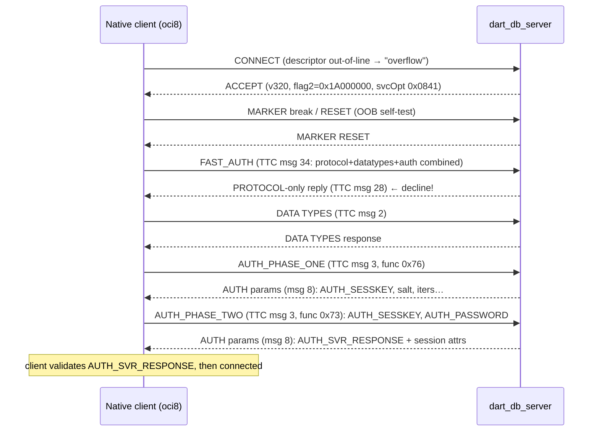

# Native (thick) Oracle client authentication — field notes

> **Status:** implemented and validated. A real PHP `oci8` thick client
> (Instant Client 23.9) authenticates against `dart_db_server`'s Oracle wire
> front-end (`oci_connect` returns a usable connection). This document records
> what the native OCI/OCCI client does differently from thin clients and the
> non-obvious things that have to be exactly right — so nobody has to
> re-derive them from a packet trace again.
>
> Code: [`lib/server/oracle_wire.dart`](../lib/server/oracle_wire.dart),
> [`oracle_native_auth.dart`](../lib/server/oracle_native_auth.dart),
> [`oracle_tns.dart`](../lib/server/oracle_tns.dart),
> [`oracle_native_datatypes.dart`](../lib/server/oracle_native_datatypes.dart),
> [`oracle_native_replay.dart`](../lib/server/oracle_native_replay.dart).
> In-process emulator (the "other gun", no Instant Client needed):
> [`test/oracle_native_client.dart`](../test/oracle_native_client.dart),
> exercised by [`test/oracle_native_handshake_test.dart`](../test/oracle_native_handshake_test.dart).

## Why this was hard

Thin clients (node-oracledb, python-oracledb, the pure-Dart `oracledb`) are
open source, so their wire behaviour can be read off the source. The **thick**
client is `libclntsh` (closed source). It negotiates differently, marshals
authentication differently, and — critically — **validates the server back**
(mutual auth). Get any byte wrong and the failure modes are opaque: a silent
hang, an `ORA-12592: packet`, a `TNS-12535` timeout, or a blanket
`ORA-01017: invalid credential`.

The only reliable way to learn the exact bytes was to capture a real client
talking to a real Oracle 23ai container and diff it against our server (see
[Capturing the wire](#capturing-the-wire)).

## The authenticated flow

Each arrow is one TTC message inside a TNS DATA packet. After the ACCEPT, all
DATA packets use the **4-byte large-SDU** length header (`v >= 315`).



## The gotchas, in the order they bite

### 1. The client is detected by its *overflow* CONNECT

A thick client sends the connect descriptor in a **separate DATA packet** after
the CONNECT (the CONNECT announces a descriptor length but the data offset
points past the packet). Thin clients inline it. The server tags the session as
native from this "overflow" and switches to the native code path for everything
that follows (`_nativeClient` in `oracle_wire.dart`).

### 2. The out-of-band break probe → negotiate version 320

**Symptom:** the client sends an out-of-band (urgent TCP) break probe during
setup that a Dart `Socket` can't service; the handshake then stalls / aborts.

**Cause:** the client picks asynchronous I/O (and the OOB probe) when the
negotiated **version < 320** *and* the service-option bit `0x400` (PACKET_IO)
is set — together they turn on the `0x200` async-I/O bit (`gbl`).

**Fix:** negotiate **version 320** for native clients, and return the ACCEPT
with `0x400` **cleared** (the client's `0x0C41` → `0x0841`). A real 23ai
listener does exactly this. The v320 ACCEPT is a **61-byte** layout with the
`flag2` word at absolute offset 41 and a 16-byte break cookie at 45–60. With
both in place the OOB probe count drops to zero.

### 3. FAST_AUTH must be *declined*, not answered

**This is the big one.** The native client opens with a **FAST_AUTH** message
(TTC type **34**) that batches PROTOCOL + DATA-TYPES + AUTH_PHASE_ONE into one
round trip. The intuitive move — reply with a combined response — makes the
client **hang**.

A real 23ai listener **declines** fast auth: it replies with a **protocol-only**
response (TTC type **28**, carrying just the server banner + charset
negotiation). The client then falls back to the **classical** path: a separate
DATA TYPES exchange, then AUTH_PHASE_ONE, then AUTH_PHASE_TWO.

So the server ignores the FAST_AUTH body and replays the captured type-28
response (`nativeProtocolResponse28`). The ACCEPT still advertises
`flag2 = 0x1A000000` (which *includes* the FAST_AUTH bit `0x10000000`) — the
client is *allowed* to try fast auth; the server just says "no, do it the long
way".

### 4. The DATA-TYPES response must match the client build

The native client strictly parses the DATA-TYPES type list. The response is
replayed verbatim from a capture of the **same client build** (oci8 /
Instant Client 23.9) in `nativeDataTypesResponse`. An older capture (from a
different build) is 122 bytes different and makes the client **abort after
phase one** — so if you upgrade the client, re-capture this blob.

### 5. Native key/value marshaling is OCI-RPC, not the thin UB layout

Native AUTH messages marshal very differently from the thin client's
self-describing UB4 key/value pairs:

* **Pointer indicators:** 8-byte `FE FF FF FF FF FF FF FF` arguments punctuate
  the request preamble. Parsing starts by skipping to the first `0xFE`.
* **Preamble:** `IND, UB4LE(userLen), UB4LE(authMode), IND, UB4LE(numPairs),
  IND, IND, U8(userLen), username`. (The FAST_AUTH-embedded variant carries an
  *extra* 4-byte flag word after `numPairs` — but we decline fast auth, so the
  classical preamble above is what the server parses.)
* **Each pair:** `UB4LE(keyLen) U8(keyLen) key  <value>  UB4LE(flags)`. The
  server ignores the flags.
* **Values** are the subtle part:
  * length `0` → just `UB4LE(0)`, **no** inline byte, no data;
  * short (`< 254`) → `UB4LE(len) U8(len) bytes`;
  * long (`>= 254`, e.g. `AUTH_CONNECT_STRING`) → `UB4LE(len) 0xFE`
    then **chunked**: `UB4LE(chunkSize) bytes … UB4LE(0)` terminator.
    Chunk sizes are **4-byte little-endian**, *not* Oracle UB4 varint — the
    first wrong assumption here throws `integer too large`.

See `parseNativeAuthPairs` / `_readNativeValue` in `oracle_native_auth.dart`.

### 6. O5LOGON / PBKDF2 crypto (12c verifier `0x4815`)

The native client requires the 12c PBKDF2 verifier (`addPbkdf2User`); a SHA512
user won't do. Phase one hands the client the challenge; phase two proves the
password. Both sides derive the same keys:

```
passwordHash = SHA512( PBKDF2-HMAC-SHA512(password,
                 salt + "AUTH_PBKDF2_SPEEDY_KEY", iterations, 64) + salt )[0:32]

serverNonce  = AES-256-CBC-decrypt(key=passwordHash, iv=0, AUTH_SESSKEY_phase1)
clientNonce  = 32 random bytes
AUTH_SESSKEY = hex( AES-256-CBC-encrypt(key=passwordHash, iv=0, clientNonce) )   (phase 2)

comboKey     = PBKDF2-HMAC-SHA512( hex(clientNonce[0:32] + serverNonce[0:32]),
                 mixingSalt, mixingIterations, 32 )

AUTH_PASSWORD = hex( AES-256-CBC-PKCS7(key=comboKey, iv=0, random16 + password) )
```

The server decrypts `AUTH_PASSWORD`, drops the 16-byte prefix, re-derives
`passwordHash`, and compares it to the stored verifier. The IV is always 16
zero bytes.

### 7. AUTH_SVR_RESPONSE — the mutual-auth proof (the `ORA-01017` culprit)

**Symptom:** the server verifies the password and sends a success response, but
the client *still* reports `ORA-01017`.

**Cause:** the thick client validates the **server** too. The success response
must carry `AUTH_SVR_RESPONSE`, a 96-hex-char value the client decrypts under
the combo key and checks. Thin clients don't require it; the OCI client does.

**Algorithm** (reverse-engineered by decrypting a captured value with the known
combo key):

```
plaintext         = random16 + "SERVER_TO_CLIENT"            (32 bytes)
AUTH_SVR_RESPONSE = hex( AES-256-CBC-PKCS7(key=comboKey, iv=0, plaintext) )
```

The client decrypts under the combo key and checks that bytes **[16:32]** equal
the ASCII literal `SERVER_TO_CLIENT`. That proves the server also derived the
combo key — i.e. it knew the password — without revealing it. See
`_buildServerResponse` in `oracle_native_auth.dart`; the combo key is stashed in
`AuthPhaseState.comboKey` during verification.

### 8. After auth: native query execution

Authentication is complete; the next frontier is **EXECUTE** (OALL8, RPC
function `0x5E`). The native call packet is `piggyback(107) + piggyback(176) +
OALL8`, where the piggybacks and the OALL8 argument list use the OCI-RPC layout
(8-byte `FE FF…` pointer indicators, 4-byte little-endian scalars) — which the
thin piggyback walker and `decodeExecuteRequest` can't step over (`integer too
large`). The server handles the **request** side:

* native post-auth DATA packets are routed to `_handleNativeCall`
  (`oracle_wire.dart`), bypassing the thin piggyback loop;
* `decodeNativeExecuteRequest` (`oracle_execute.dart`) recovers the SQL by
  scanning for its inline `U8(len)` length-prefixed ASCII run, runs it through
  the engine, and the statement executes (server log: `EXECUTE [cursor 1]
  "select 1 as v from dual"`). Re-executed cursors and binds are not yet
  decoded on this path.

What remains is the **response**: the native describe/row format differs from
thin. A thin `buildQueryResponse` for one NUMBER column is
`10 00 00 01 01 00 02 …` (117 bytes); a real listener returns
`10 17 00 00 00 <16-byte describe signature> …` (307 bytes) — message type 16
(describe-info) but with the native marshaling (4-byte little-endian scalars,
`U8(len)`-prefixed strings), the column metadata, the base-100 NUMBER row value
(`C1 02` for `1`), and an `ORA-01403: no data found` terminal.

`buildNativeQueryResponse` (`oracle_native_execute.dart`) now builds this for a
**single-row** result of any number of NUMBER / VARCHAR2 columns, and a real
`oci8` client round-trips `select 1 from dual`, `select 'AB' c1, 7 c2 from
dual`, mixed-type multi-column selects, etc. Two findings from the capture made
it tractable: the 16-byte describe signature is **not validated** (zeros work),
and the describe timestamp + the per-execute sequence counters in the status
block are **not validated** either (constant blocks captured once are replayed
for every query). The column-count shows up in three places — `ncols` in the
header, `0x22,ncols` in the mid block, `ncols+5` in the status block — and each
column carries its 0-based index in its record; everything else is a fixed
template. **Empty (0-row)** results use a truncated mid block (no row-metadata
tail), no row data, and a distinct status block. **Multi-row** results (inter-row
`0x15 01 00 01` markers), binds, DML row counts, and `ALTER SESSION` (which
returns an NLS parameter block) are the remaining work.


## Capturing the wire

SQLNET client tracing (`TRACE_LEVEL_CLIENT=16`) proved unreliable here — the
Instant Client didn't honour `TNS_ADMIN` in the test setup, so no trace files
appeared. The reliable method was a **tiny TCP relay** between the client and a
real Oracle container that logs every chunk in both directions as hex:

1. Run a ~20-line Dart proxy: listen on `127.0.0.1:1523`, forward to the
   container on `127.0.0.1:1521`, and append `C->S <len> <hex>` /
   `S->C <len> <hex>` lines to a log.
2. Point the client at the proxy port.
3. Decode each chunk: 4-byte big-endian length at `[0..3]`, packet type at
   `[4]`, data flags at `[8..9]`, TTC message type at `[10]`.

Because each TCP chunk corresponded to exactly one large-SDU NS packet, the log
was directly decodable. The static responses (type-28 protocol decline,
DATA-TYPES) were lifted verbatim into `oracle_native_replay.dart` /
`oracle_native_datatypes.dart`; the crypto values (`AUTH_SESSKEY`,
`AUTH_SVR_RESPONSE`) were decrypted offline with the known password to recover
the algorithms above.

> The proxy and decode scripts are throwaway — they are **not** checked in, and
> traces can contain an encrypted password, so delete them after use.

## The emulator mirrors all of this

`test/oracle_native_client.dart` is a pure-Dart stand-in for the thick client.
`NativeThickClient.login(username:, password:)` drives the entire flow —
overflow CONNECT, break/reset, FAST_AUTH decline, DATA TYPES, AUTH_PHASE_ONE,
and AUTH_PHASE_TWO — running the real O5LOGON/PBKDF2 client crypto and
**validating `AUTH_SVR_RESPONSE`** just like `oci8` does. It lets the native
auth path be tested end-to-end in CI without an Instant Client install.
