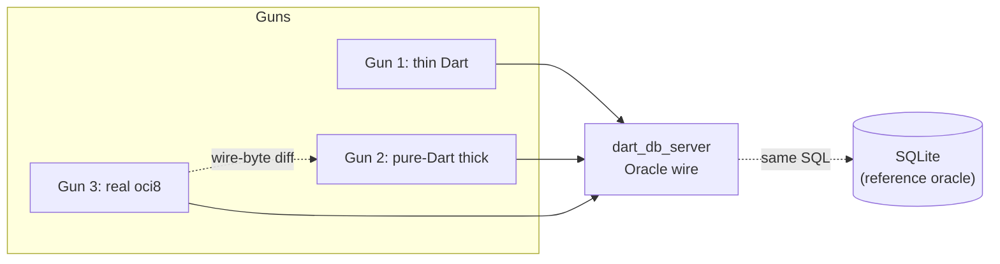

# Triple-threat testing: validating the server *and* the thick client with real `oci8`

> **Audience:** whoever runs the reliability / differential harness. This is the
> instruction to add a **third gun** — the real Oracle thick client (`oci8` /
> Instant Client) — alongside the two Dart clients we already drive the server
> with. Using all three is the "triple threat": a bug has to fool a thin client,
> a from-scratch pure-Dart thick client, **and** closed-source `libclntsh`
> before it reaches a user.

## The three guns

| Gun | What it is | What it proves |
|-----|------------|----------------|
| **1. Thin Dart** | `package:oracledb` thin mode (open source, UB-varint wire) | Server speaks the documented thin TTC dialect. |
| **2. Pure-Dart thick** | [`lib/oracle_thick_client.dart`](../lib/oracle_thick_client.dart) — our own native (OCI/OCCI, v320) client | Server speaks the *native* dialect; and the client itself round-trips auth + query + DML + FETCH. |
| **3. Real `oci8`** | Oracle Instant Client 23.9 via PHP `oci8` / `python-oracledb` thick / `node-oracledb` thick (closed-source `libclntsh`) | Ground truth: a real Oracle client works against the server, and its bytes are the reference the pure-Dart thick client is diffed against. |

"Test against **both the server and the client**" means Gun 3 is used two ways:

- **Against the server** — point real `oci8` at `dart_db_server` and confirm a
  full connect → query → DML lifecycle works (§ [Gun 3 vs the server](#gun-3-against-the-server)).
- **Against the pure-Dart client** — capture the bytes real `oci8` puts on the
  wire for a statement and diff them against what `oracle_thick_client.dart`
  emits for the same statement (§ [Gun 3 vs the client](#gun-3-against-the-client)).



## Start the server

Run the Oracle wire front-end on a real port with a **PBKDF2** user (native
thick clients require the 12c verifier — a plain `--oracle-user` will not let a
thick client log in):

```bash
dart run bin/dart_db_server.dart \
  --memory \
  --oracle-port 1521 \
  --oracle-pbkdf2-user native/Secret123
```

- `--memory` keeps it ephemeral; drop it (or add `--file db.json`) to persist.
- The service name is not validated (the server tags a session native from the
  connect *overflow* flow, not the descriptor), so any `/SERVICE` works — use
  `FREEPDB1` in connect strings to match the examples below.

## Gun 1 — thin Dart (reference, already wired)

Standard `package:oracledb` in thin mode against `localhost:1521/FREEPDB1`.
Nothing new here; it is the existing differential path.

## Gun 2 — pure-Dart thick client

Import the library and drive the native path with no Instant Client installed:

```dart
import 'package:dart_db_server/oracle_thick_client.dart';

final c = await OracleThickClient.connect(1521);
final login = await c.login(username: 'native', password: 'Secret123');
assert(login.authenticated);

await c.execute('CREATE TABLE t (id INTEGER PRIMARY KEY, name VARCHAR2(40))');
await c.execute("INSERT INTO t (id, name) VALUES (1, 'alice')"); // -> 1

final r = await c.query('SELECT id, name FROM t WHERE id > :min', binds: [0]);
print(r.columns); // [id, name]
print(r.rows);    // [[1, alice]]

await c.close();
```

`query` / `execute` encode a native OALL8 EXECUTE (with FETCH pagination past
100 rows) and decode NUMBER (base-100) and VARCHAR2 (UTF-8); an `ORA-xxxxx`
surfaces as `OracleThickException`. See
[`test/oracle_thick_client_roundtrip_test.dart`](../test/oracle_thick_client_roundtrip_test.dart)
for the full matrix.

## Gun 3 — real Oracle `oci8` / Instant Client

### Install

Install Oracle **Instant Client 23.x** (Basic + SDK) for your platform, matching
the **host architecture** of the process that loads it (the thick client is
native `libclntsh`; e.g. an x86_64 PHP must use an x86_64 Instant Client — on
Apple Silicon run it under an x86_64 runtime or use an x86_64 container).

- PHP: enable the `oci8` extension (`pecl install oci8`), pointing it at the
  Instant Client.
- Python: `pip install oracledb` (it ships thin; call `init_oracle_client()` to
  switch to thick, which loads Instant Client).
- Node: `npm i oracledb` and `oracledb.initOracleClient()`.

### Gun 3 against the server

Point any thick client at the running `dart_db_server` and run the lifecycle.

**PHP `oci8`:**

```php
<?php
$c = oci_connect('native', 'Secret123', '//127.0.0.1:1521/FREEPDB1');
if (!$c) { $e = oci_error(); exit($e['message']); }

oci_execute(oci_parse($c, 'CREATE TABLE t (id INTEGER PRIMARY KEY, name VARCHAR2(40))'));
$ins = oci_parse($c, 'INSERT INTO t (id, name) VALUES (:id, :name)');
oci_bind_by_name($ins, ':id', $id);  oci_bind_by_name($ins, ':name', $name);
$id = 1; $name = 'alice'; oci_execute($ins);

$sel = oci_parse($c, 'SELECT id, name FROM t ORDER BY id');
oci_execute($sel);
while ($row = oci_fetch_array($sel, OCI_ASSOC)) { print_r($row); }
oci_close($c);
```

**`python-oracledb` (thick mode):**

```python
import oracledb
oracledb.init_oracle_client()  # loads Instant Client -> thick mode
c = oracledb.connect(user="native", password="Secret123",
                     dsn="127.0.0.1:1521/FREEPDB1")
cur = c.cursor()
cur.execute("CREATE TABLE t (id INTEGER PRIMARY KEY, name VARCHAR2(40))")
cur.execute("INSERT INTO t VALUES (:id, :name)", id=1, name="alice")
print(cur.execute("SELECT id, name FROM t WHERE id > :m", m=0).fetchall())
c.close()
```

Pass criteria: connect succeeds, the `SELECT` returns the inserted rows, DML
reports the right row counts, and `oci_close` / `connection.close()` tears down
without an `ORA-`/`TNS-` error. That is the same lifecycle Gun 1 and Gun 2 run —
compare results three ways against the SQLite reference.

### Gun 3 against the client

Use real `oci8` as the **byte reference** for the pure-Dart thick client: capture
what `libclntsh` sends for a statement, then confirm `oracle_thick_client.dart`
emits an equivalent EXECUTE for the same SQL.

1. Put a tiny TCP relay between the thick client and the server that logs each
   chunk both ways as `C->S <len> <hex>` / `S->C <len> <hex>` (the method in
   [oracle-native-thick-client-auth.md § Capturing the wire](./oracle-native-thick-client-auth.md#capturing-the-wire)).
   Run real `oci8` through it against `dart_db_server` (or a real 23ai container).
2. Decode the `C->S` DATA packet for the statement: 4-byte big-endian length at
   `[0..3]`, type `6` at `[4]`, TTC call `03` + function `5E` (OALL8) at
   `[10..11]`, then the SQL and the tail `07` bind block.
3. Encode the same SQL + binds with `oracle_thick_client.dart` (the private
   EXECUTE encoder is exercised end-to-end by the round-trip test) and diff the
   SQL run and bind values. They should match; a divergence is a client bug.

> Traces can contain an encrypted password — treat the relay logs as secrets and
> delete them after use. The relay/decoder scripts are throwaway, not checked in.

## Wire it into the differential harness

For each query/DML case the harness already runs against SQLite, add the two
extra server paths so every case is checked by all three guns:

1. Run the statement on **SQLite** (reference result).
2. Run it against **`dart_db_server`** via Gun 1 (thin) and Gun 2 (pure-Dart
   thick); assert both match SQLite (columns, row values, affected count).
3. Periodically (not every fuzz iteration — it needs Instant Client) run the
   same case via **Gun 3** (`oci8`) against the server and assert it matches too,
   and spot-check Gun 3's EXECUTE bytes against Gun 2's per § [Gun 3 vs the client](#gun-3-against-the-client).

A case that passes Gun 1 and Gun 2 but fails Gun 3 means the server emits bytes
the open-source clients tolerate but real Oracle does not — exactly the class of
bug the third gun exists to catch.
