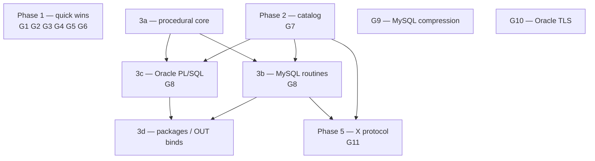

# Roadmap: closing the Oracle & MySQL parity gaps

Companion to [sql-dialect-parity.md](sql-dialect-parity.md). That document is a
snapshot of **what works today**; this one is the ordered plan for **what's
left**, with scope, an implementation sketch grounded in the real source, a
relative effort/risk rating, dependencies, and acceptance criteria for each
item.

Effort is relative, not calendar-based:

| Size | Meaning |
| --- | --- |
| **S** | Isolated change in one or two files (a parser tail + an evaluator branch). |
| **M** | Multi-file feature touching parser + executor (+ sometimes a wire codec). |
| **L** | A new subsystem, or a feature that reshapes an existing hot path. |
| **XL** | A major subsystem spanning parse, execution, and protocol. |

> **Standing principle.** Every item lands against the **shared engine**, so a
> fix is delivered to Oracle **and** MySQL clients at once. Each item ships with
> a self-contained engine test *and* a real-client validation test (`oracledb`
> and/or `mysql_client`), matching the current cadence.

---

## Gap inventory

| # | Gap | Surface | Size | Risk | Status |
| --- | --- | --- | --- | --- | --- |
| G1 | `ROWNUM` nested in a scalar expression | Oracle/engine | S | low | ✅ done |
| G2 | `seq.NEXTVAL` once-per-row guarantee | Oracle/engine | S | low | ✅ done |
| G3 | Stale `mysql_wire.dart` header comment | MySQL/docs | S | none | ◻ |
| G4 | `NCLOB` (UTF-16 CLOB) | Oracle wire | M | low | ◻ |
| G5 | `INSERT ALL` / `INSERT FIRST` (multi-table insert) | Oracle | M | low | ✅ done |
| G6 | `CONNECT BY` hierarchical queries | Oracle | M | medium | ✅ done |
| G7 | Catalog / data-dictionary views (`INFORMATION_SCHEMA`, `USER_*`/`ALL_*`) | both | M | low | ◻ |
| G8 | Procedural routines — MySQL stored procs + Oracle PL/SQL | both | XL | high | ◻ |
| G9 | MySQL wire compression (`CLIENT_COMPRESS`, zstd) | MySQL wire | M | medium | ◻ |
| G10 | Real-client **Oracle TLS** | Oracle wire | M | external | ◻ |
| G11 | MySQL **X protocol** (DevAPI, port 33060) | MySQL wire | XL | medium | ◻ |

---

## Phase 1 — Quick wins & correctness

Small, self-contained, low-risk items that remove the asterisks in the parity
doc. No shared infrastructure required.

### G1 · `ROWNUM` nested in a scalar expression — **S** — ✅ done
Today `ROWNUM` lowers to `ROW_NUMBER() OVER ()` ([`parser.dart`](../lib/server/parser.dart)),
which the window engine only evaluates at the **top level** of a projection
item — so `'row ' || ROWNUM` fails with *Unknown function: ROW_NUMBER*.
- **Sketch:** teach the window-function evaluator in
  [`database.dart`](../lib/server/database.dart) to detect window calls nested
  inside a projection expression: pre-compute each row's window value, bind it
  into the row scope under a synthetic name, and rewrite the nested call to a
  reference. (Also fixes nested `ROW_NUMBER()`/`RANK()` generally.)
- **Done when:** `SELECT 'r'||ROWNUM FROM t` and `SELECT ROWNUM*10 FROM t`
  return the expected values; existing window tests stay green.

### G2 · `NEXTVAL` once-per-row — **S** — ✅ done
Multiple `seq.NEXTVAL` references in one row currently advance per reference;
Oracle guarantees one advance per row.
- **Sketch:** add a per-row memo keyed by sequence name on the
  `SequenceProvider` path (`SequenceExpr`/`Database`), cleared at each row
  boundary in the INSERT/SELECT executors.
- **Done when:** `SELECT s.NEXTVAL, s.NEXTVAL FROM dual` yields two equal values.

### G3 · Correct the `mysql_wire.dart` header comment — **S**
The doc comment still lists prepared statements, TLS, and
`caching_sha2_password` as TODO, though all three are implemented and tested.
- **Done when:** the comment reflects the real scope and lists only compression
  + X protocol as remaining gaps.

### G4 · `NCLOB` — **M**
Completes the LOB story (`CLOB`/`BLOB` already work).
- **Sketch:** thread the character-set-form (`csfrm = NChar`) through
  describe/bind/fetch in [`oracle_execute.dart`](../lib/server/oracle_execute.dart)
  and the column-LOB path in [`oracle_lob.dart`](../lib/server/oracle_lob.dart);
  encode NCLOB bodies as UTF-16BE; set `csfrm = 2` in the column describe.
- **Done when:** an `NCLOB` column round-trips multibyte text through the real
  `oracledb` client; length is reported in characters.

### G5 · `INSERT ALL` / `INSERT FIRST` — **M** — ✅ done
Oracle multi-table insert.
- **Sketch:** new `InsertAllStmt` AST (list of `INTO target (cols) VALUES
  (exprs)` arms, optional `WHEN cond THEN` guards, a driving `SELECT`); a
  `_insertAll` executor that evaluates the source row-by-row and fans out to the
  existing `_insert` path per matching arm (`FIRST` stops at the first matching
  `WHEN`). Reuses all constraint/index/trigger machinery, mirroring how
  [`_merge`](../lib/server/database.dart) defers to `_insert`.
- **Done when:** unconditional, conditional (`WHEN`), and `FIRST` forms land
  rows in multiple targets; `ELSE` arm handled.

### G6 · `CONNECT BY` hierarchical queries — **M** — ✅ done (core; `SYS_CONNECT_BY_PATH` / `CONNECT_BY_ROOT` deferred)
`START WITH … CONNECT BY PRIOR …`, plus `LEVEL`, `CONNECT_BY_ROOT`,
`SYS_CONNECT_BY_PATH`, `CONNECT_BY_ISLEAF`, and `ORDER SIBLINGS BY`.
- **Sketch:** the engine already has a recursive-CTE executor
  (`_parseWith` + the anchor/recursive-arm loop in
  [`database.dart`](../lib/server/database.dart)). Parse `CONNECT BY` into a
  `HierarchicalClause` on `SelectStmt` and **desugar to a recursive traversal**
  reusing that machinery: `START WITH` = the anchor predicate, `CONNECT BY PRIOR`
  = the recursive join predicate. Maintain `LEVEL`, a root value, and an
  accumulated path in the per-row scope; detect `CONNECT_BY_ISLEAF` on the final
  pass. Cycle detection via `NOCYCLE`.
- **Risk:** medium — pseudo-columns (`LEVEL` etc.) must be injected into the row
  scope and survive projection; interaction with `WHERE` (filtered after the
  hierarchy) needs care.
- **Done when:** a manager/employee tree query returns rows in hierarchy order
  with correct `LEVEL` and `SYS_CONNECT_BY_PATH`.

---

## Phase 2 — Catalog / data dictionary (G7) — **M**

A single catalog layer backs **both** dialects' introspection, so build it once.

- **Sketch:** a read-only virtual-view provider that materializes rows from the
  live in-memory schema (`_tables`, `_views`, `_sequences`, indexes, columns) on
  demand. Register dialect-specific view names over the same provider:
  - **MySQL:** `INFORMATION_SCHEMA.TABLES`, `.COLUMNS`, `.STATISTICS`,
    `.KEY_COLUMN_USAGE`, `.SCHEMATA`, `.VIEWS`, plus `SHOW` commands routed
    through them.
  - **Oracle:** `USER_TABLES`/`ALL_TAB_COLUMNS`/`USER_SEQUENCES`/`USER_CONS_*`
    data-dictionary views and `DUAL` (already synthesized).
- **Why now:** it's a prerequisite for ORMs and GUI tools (Workbench, SQL
  Developer, DBeaver) that introspect the catalog before running queries.
- **Done when:** `SELECT * FROM information_schema.columns WHERE table_name=…`
  and `SELECT * FROM user_tables` return accurate rows; a GUI client can browse
  the schema.

---

## Phase 3 — Procedural routine engine (G8) — **XL**

The single largest gap, and deliberately shared: **MySQL stored
procedures/functions** and **Oracle PL/SQL** are two dialects over one
procedural interpreter. Triggers already prove the engine can run statement
bodies inline ([`_TriggerSpec`](../lib/server/database.dart)); this generalizes
that into a real control-flow interpreter.

Sequenced sub-phases so value lands incrementally:

1. **3a — Procedural core (L).** A block interpreter: local variables,
   assignment, `IF/ELSIF/ELSE`, `WHILE`/`LOOP`/`FOR`, `RETURN`, and calling the
   existing `Database.execute` for embedded SQL. Shared AST under a new
   `routine.dart`.
2. **3b — MySQL routines (M).** `DELIMITER` handling in the MySQL front-end,
   `CREATE PROCEDURE`/`CREATE FUNCTION`, `CALL`, `IN`/`OUT`/`INOUT` params,
   `DECLARE`, result-set passthrough. Store routines in a `_routines` catalog.
3. **3c — Oracle PL/SQL (L).** Anonymous `BEGIN … END;` blocks, `CREATE
   PROCEDURE`/`FUNCTION`, cursors (`OPEN`/`FETCH`/`CLOSE`, `%ROWTYPE`,
   `%FOUND`), `EXCEPTION … WHEN`, and `DBMS_OUTPUT` capture. Route via the TTC
   execute path.
4. **3d — Packages & bind-out (M).** `CREATE PACKAGE`/`BODY`, `OUT` binds over
   both wires, ref-cursor returns from functions (the wire already supports ref
   cursors).
- **Risk:** high — new execution model, transaction/savepoint interaction,
  error-mapping to each protocol's error packets, and recursion/termination
  guards.
- **Done when:** a stored procedure with `IN`/`OUT` params runs via
  `mysql_client`, and an anonymous PL/SQL block with a cursor loop runs via
  `oracledb`.

---

## Phase 4 — Protocol depth

### G9 · MySQL wire compression — **M**
`CLIENT_COMPRESS` (zlib) and the modern `zstd` compression capability.
- **Sketch:** wrap the packet reader/writer in
  [`mysql_wire.dart`](../lib/server/mysql_wire.dart) with a compressed-packet
  framing layer (3-byte compressed length, seq, 3-byte uncompressed length)
  negotiated from the client capability flags; `package:archive` for zlib.
- **Done when:** a client connecting with compression enabled round-trips large
  result sets; uncompressed clients are unaffected.

### G10 · Real-client Oracle TLS — **M, partly external**
Server-side TLS exists; the real `oracledb` thin client's `upgradeToTls` uses
`cancel()` then `SecureSocket.secure`, which kills the socket read side against
*any* Dart TLS server. Root cause is the **client SDK**, not the server.
- **Sketch:** (a) reproduce in the sibling `../dart-oracledb` client and fix its
  TLS-upgrade sequence (prefer `SecureSocket.secure` without the premature
  `cancel()`), contributing the fix upstream; (b) add a server-side tolerance
  path if feasible; (c) land the previously-skipped real-client TLS validation
  test once unblocked.
- **Done when:** `oracledb` connects over TLS to the server and runs a query.

---

## Phase 5 — MySQL X protocol (G11) — **XL**

The MySQL 8 X DevAPI on port 33060 — a protobuf-framed protocol, effectively a
second front-end.
- **Sketch:** a new `mysqlx_wire.dart` server: Protobuf message framing
  (`Mysqlx.*` messages), `Sess.AuthenticateStart/Continue` (SHA256/MySQL41),
  `Crud.Find/Insert/Update/Delete` translated to engine statements, and
  `Sql.StmtExecute` for raw SQL. Reuses the same `Database` core; needs a
  protobuf codec (hand-rolled or `package:protobuf`).
- **Why last:** largest surface, smallest audience (most tooling uses the
  classic protocol, already supported).
- **Done when:** a MySQL X client (`mysqlx` shell / connector) connects and runs
  CRUD + SQL.

---

## Dependency & sequencing graph

Phase 1 and Phase 2 are independent and can proceed in parallel. The procedural
core (3a) gates both routine dialects. Compression (G9) and TLS (G10) are
independent of everything else. The X protocol (G11) benefits from the catalog
(G7) and MySQL routines (3b) but doesn't strictly require them.

---

## Cross-cutting: hardening

Applies across phases, not a dated milestone:

- **Fuzzing** the Oracle TNS/TTC and MySQL packet parsers against malformed
  frames (truncated length, oversized claims, bad seq).
- **Error-mapping** fidelity: each new feature's failure modes should surface as
  the correct ORA-/MySQL error code, not a generic engine `StateError`.
- **Dual-environment integration** (Oracle 23ai + 21c) kept green per the repo's
  `AGENTS.md` rule.

---

## Definition of "parity closed"

Parity is considered closed when:

1. The parity-doc gap tables ([sql-dialect-parity.md](sql-dialect-parity.md) §6)
   are empty or reduced to explicit, documented non-goals.
2. A representative ORM/tool works end-to-end over each wire: e.g. a schema
   browse + CRUD + a stored routine via `mysql_client`, and the same via
   `oracledb` including a PL/SQL block.
3. Every item above has a self-contained engine test and a real-client
   validation test, with the dual-env Oracle suites green.
